<!-- Generated by scripts/build_assets.py - edit CFG there, not this file. -->

  

  
  
  
  

  

  
  
  

  
  
  
  
  
  

<b>●</b> core, what I'd happily be interviewed on &nbsp;·&nbsp; <b>○</b> working knowledge

  <a href="https://github.com/VisheshDubey26/AI-Cyber-Threat-Intelligence"></a>
  
  
  <a href="https://github.com/shashwat2645?tab=repositories&q=deadline"></a>

  
  
  

  

  

  

Prefer plain text? <a href="mailto:shashwats2604@gmail.com">shashwats2604@gmail.com</a>

